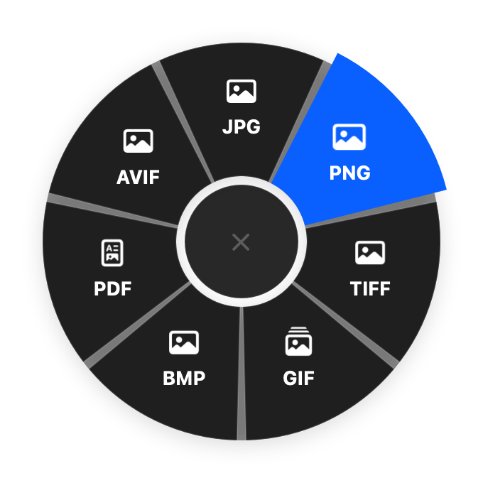
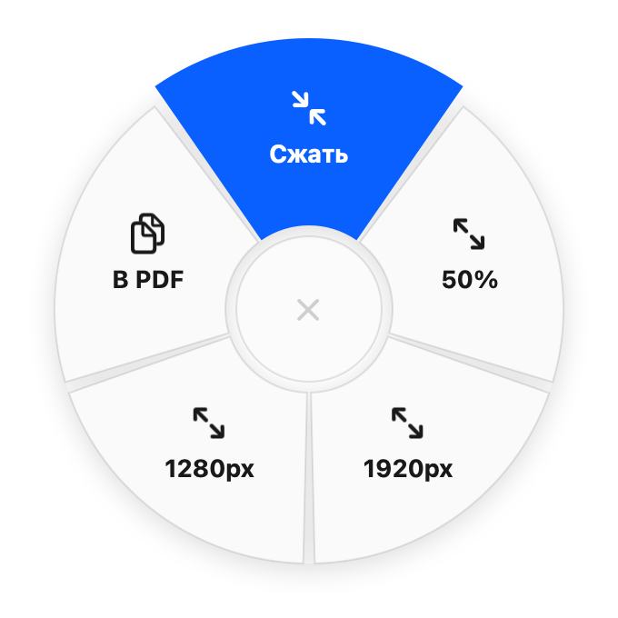

# DropWheel

Конвертер файлов для macOS, который живёт в строке меню. Начни тащить файл и зажми клавишу — вокруг курсора появится колесо. Брось файл на сектор, и копия в новом формате появится рядом с оригиналом.

- **Shift** — сменить формат: картинки (JPG, PNG, HEIC, TIFF, GIF, BMP, PDF, AVIF), видео (MP4, MOV, HEVC, 1080p, 720p, звук в M4A), аудио (M4A, WAV, AIFF), PDF в картинки.
- **Command** — инструменты: сжать, обрезать (окно с выбором области и соотношения сторон), уменьшить, собрать картинки в PDF, убрать звук из видео, склеить и разделить PDF.

<p>
  
  
</p>

Колесо подстраивается под светлую и тёмную тему системы. Во время конвертации видео плашка показывает прогресс, клик по ней отменяет работу.

Работает на встроенных средствах macOS, без сторонних программ и системных разрешений.

## Сборка

Нужны macOS 15+ и Xcode. Открой `DropWheel.xcodeproj` и нажми Run, либо из терминала:

```bash
xcodebuild -project DropWheel.xcodeproj -target DropWheel -configuration Release SYMROOT="$PWD/build"
```

Готовое приложение появится в `build/Release/DropWheel.app`.

## Тесты

```bash
tests/run.sh
```

Скрипт собирает приложение и проверяет все конвертации и инструменты на свежих тестовых файлах.
